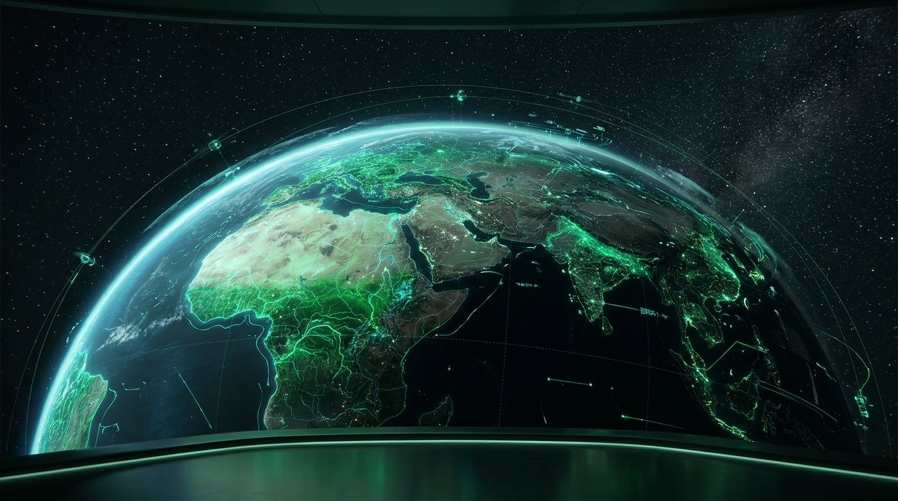
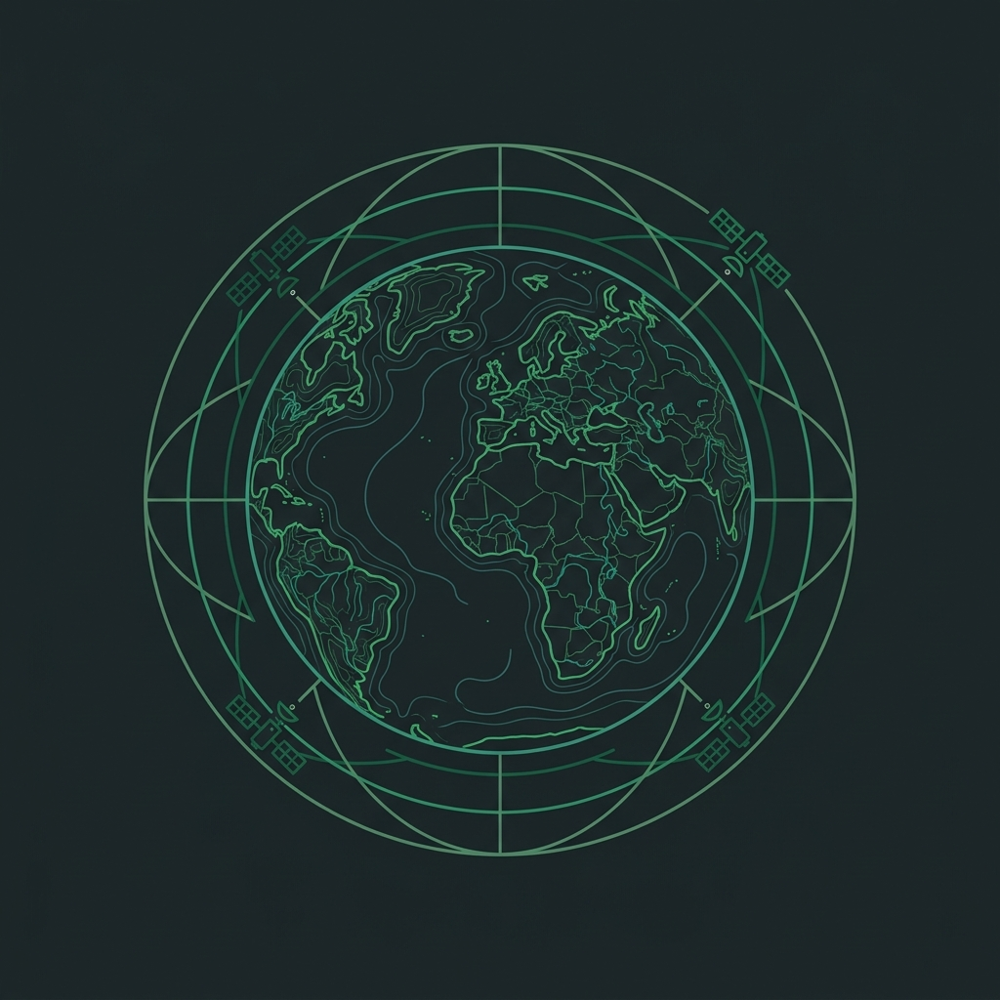
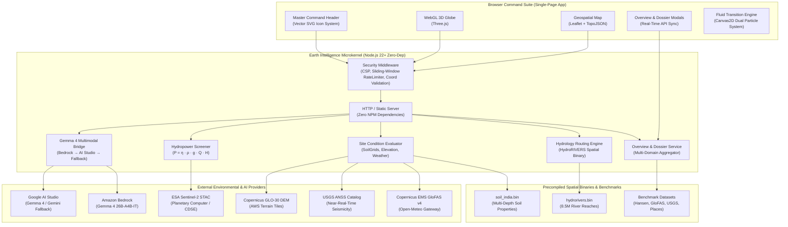
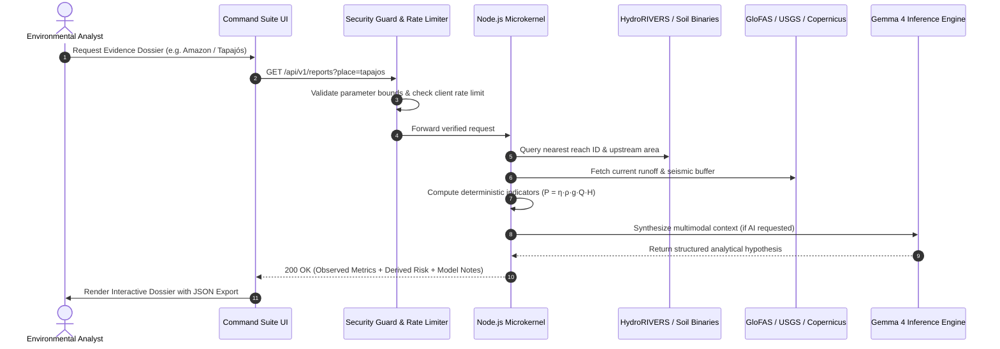

<div align="center">

  

  # EARTH INTELLIGENCE
  ### Planetary Intelligence, Environmental Monitoring & Risk Synthesis Platform

  [](LICENSE)
  [](https://nodejs.org)
  [-blue.svg)](package.json)
  [](backend/security.js)
  [-purple.svg)](backend/gemma.js)
  [](backend/datasets/README.md)

  <p align="center">
    <strong><em>"Understand our planet. Detect change. Act on evidence."</em></strong>
  </p>

  <p align="center">
    <a href="#1-product-overview">Overview</a> •
    <a href="#2-visual-showcase">Visual Showcase</a> •
    <a href="#3-core-capabilities">Capabilities</a> •
    <a href="#4-architecture">Architecture</a> •
    <a href="#5-getting-started">Getting Started</a> •
    <a href="#6-api-documentation">API Reference</a> •
    <a href="#7-security-posture">Security</a> •
    <a href="#8-scientific-data-sources--attribution">Citations</a>
  </p>

  

</div>

---

## 1. Product Overview

**Earth Intelligence** is an evidence-driven planetary observation and environmental intelligence platform. It unifies high-resolution satellite imagery, topological river hydrography, machine-learning soil mapping, seismic catalogs, and multimodal AI into a single aerospace-grade command suite.

### The Problem
Traditional environmental tooling is fragmented: satellite imagery lives in complex GIS silos, hydrological routing models require specialized HPC infrastructure, and deforestation data is locked in annual academic releases. When disasters strike or infrastructure is planned, decision-makers are forced to either piece together incompatible datasets or rely on speculative generative AI models that hallucinate risk factors.

### The Earth Intelligence Solution
Earth Intelligence enforces **transparent evidence hierarchy**:
1. **Ground & Satellite Observations:** Hard physical measurements (Hansen/UMD 30m forest loss, USGS seismic records, Sentinel-2 surface reflectance, GloFAS v4 runoff).
2. **Deterministic Computations:** Peer-reviewed mathematical formulations ($P = \eta \cdot \rho \cdot g \cdot Q \cdot H$ for hydropower, Dogliotti turbidity algorithms, Strahler routing).
3. **AI-Assisted Synthesis:** Gemma 4 multimodal models correlate disparate spatial factors into executive environmental dossiers, clearly distinguished from raw observations.

### Target Users
- **Environmental & Climate Researchers:** Investigate multi-decade forest canopy dynamics and river basin sediment flux.
- **Disaster Response & Relief Agencies:** Real-time flood surge monitoring, seismic proximity buffering, and emergency site assessment.
- **Conservation & NGO Teams:** Track deforestation alerts, estimate biomass carbon emissions, and plan native reforestation goals.
- **Civil Infrastructure & Hydropower Planners:** Screen potential run-of-the-river generation, dam basin impacts, and city power grids.

---

## 2. Visual Showcase

<div align="center">
  <table>
    <tr>
      <td width="50%">
        
        <p align="center"><em>Geometric Satellite & Environmental Core Emblem</em></p>
      </td>
      <td width="50%">
        
        <p align="center"><em>Unified Command Header & Multi-Basin Overview HUD</em></p>
      </td>
    </tr>
  </table>
</div>

---

## 3. Core Capabilities

### 🌳 Forest Intelligence (Forest Subsystem)
- **Hansen / UMD Global Forest Change (v1.11):** 30-meter resolution annual tree cover loss tracking (2001–2024).
- **Carbon Flux Estimation:** Above-ground biomass emissions ($Mg\ CO_2e$) and 40-year seedling recovery calculations.
- **3D Interactive WebGL Earth:** Global spatial navigation powered by Three.js with multi-layer biome overlays.
- **Treeko Environmental Assistant:** Interactive conversational agent providing ecological context on demand.

### 🌊 River Intelligence (Hydrology & Infrastructure Subsystem)
- **HydroRIVERS v1.0 Network:** Instant spatial indexing of 8.5 million river reaches with Strahler stream orders (1–9).
- **GloFAS v4.0 Flow Reanalysis:** Daily runoff timeseries, flood return period anomalies, and upstream drainage area routing.
- **Sentinel-2 Water Quality:** Multi-spectral radiometric extraction of turbidity (Dogliotti algorithm) and chlorophyll-a (NDCI).
- **City Power Planner:** Multi-objective renewable energy matching algorithm connecting urban electricity demand with viable river cascade dams.
- **Dam Atlas & Site Screener:** Run-of-the-river power output estimation ($P = \eta \cdot \rho \cdot g \cdot Q \cdot H$), hydraulic head profiling from Copernicus GLO-30 DEM, and geological buffer validation.

### ✦ Hazard Lens (Gemma 4 Multimodal Environmental Reasoning)
- **Multimodal Visual Inspection:** Ingests Sentinel-2 multispectral imagery alongside contemporaneous hydro-meteorological indicators.
- **Cross-Domain Correlation:** Detects complex cascading risks (e.g., deforestation-induced slope destabilization coupled with heavy precipitation and river gorge siltation).
- **Transparent Epistemic Guardrails:** Model responses are strictly labeled as analytical hypotheses; ground observations are explicitly displayed in parallel.

### 📋 Evidence Dossiers & Overview HUD
- **Real-Time Overview Telemetry:** Global KPIs aggregating monitored basins, flow discharge peaks, and seismic events.
- **Site Evidence Dossier:** Multi-domain forensic briefs with exportable JSON records for academic and regulatory audits.

---

## 4. Architecture



---

## 5. Data Flow



---

## 6. Technology Stack

| Layer | Technologies & Implementations | Rationale |
|---|---|---|
| **Backend Runtime** | Node.js 22+ LTS (Native `http`, `fs`, `path`, `zlib`, native `fetch`) | **Zero runtime npm dependencies** — zero supply chain risk, sub-10ms startup time, ultra-low memory footprint. |
| **Security Layer** | Custom Sliding-Window RateLimiter, Strict CSP Headers, Coordinate Validator | Defense-in-depth against resource exhaustion, SSRF, XSS, and frame injection. |
| **Multimodal AI** | Google Gemma 4 (`gemma-4-26b-a4b-it`) via Amazon Bedrock & Google AI Studio | State-of-the-art open reasoning model reading satellite imagery alongside numerical spatial metrics. |
| **Frontend Framework** | Vanilla Modern JavaScript (ES2022+), HTML5 Semantic Shell, Vanilla CSS | Maximum rendering performance, no hydration overhead, instantaneous navigation. |
| **3D & Geospatial** | Three.js (WebGL Earth), Leaflet.js, TopoJSON, Canvas2D fluid particles | Smooth 60fps globe rotation, vector river tracing, and cinematic nature-to-water viewport transitions. |
| **Iconography** | EarthIcons Vector SVG Library (`frontend/assets/icons.js`) | Replaces all non-standard emoji characters with accessible, scalable, crisp vector symbols. |
| **Spatial Datasets** | WWF HydroRIVERS v1.0, Copernicus GloFAS v4, Hansen UMD, USGS ANSS, ISRIC SoilGrids 2.0 | Scientifically verified, peer-reviewed global data baselines. |

---

## 7. Repository Structure

```
Earth Intelligence/
├── .env.example               # Environment template with documented placeholders
├── .gitignore                  # Git hygiene exclusions (secrets, logs, OS files)
├── render.yaml                # Production deployment blueprint (Render Free Tier)
├── package.json               # Package manifest, zero dependencies, npm test scripts
├── README.md                  # Comprehensive product documentation
├── docs/                      # Documentation assets
│   └── assets/                # Logos, SVGs, and architecture graphics
├── frontend/                  # High-performance client-side command suite
│   ├── index.html             # Master Command Suite Shell (Overview, Viewports, Dossiers)
│   ├── favicon.svg            # Mathematical vector SVG favicon
│   ├── transition.css         # Master aerospace dark glass theme
│   ├── transition.js          # Nature-water dual particle canvas transition engine
│   ├── assets/                # Shared vector icons and brand marks
│   │   ├── icons.js           # EarthIcons SVG icon registry
│   │   ├── icons.css          # Vector icon styles & status pulses
│   │   └── logo.svg           # Scalable vector brand emblem
│   ├── forest-eyes/           # Forest Intelligence Subsystem (3D Globe & Hansen GFW)
│   ├── river-eyes/            # River Intelligence Subsystem (HydroRIVERS, Power, Dams)
│   └── hazard/                # Hazard Lens Subsystem (Gemma 4 Multimodal Studio)
└── backend/                   # Zero-dependency Node.js server & services
    ├── server.js              # HTTP server, routing, and static file distributor
    ├── security.js            # Security middleware (CSP, RateLimiter, Coord Validator)
    ├── overview-api.js        # Overview KPI calculator & site dossier generator
    ├── gemma.js               # Multi-provider Gemma 4 client (Bedrock & AI Studio)
    ├── hazard.js              # Multimodal hazard ingestion & prompt orchestrator
    ├── rivers.js              # HydroRIVERS spatial search and stream tracing
    ├── dam.js                 # Hydropower screening & City Power Planner engine
    ├── water.js               # Sentinel-2 water quality (Turbidity, Chlorophyll-a)
    ├── water-snap.js          # Surface water alignment (JRC Global Surface Water)
    ├── site.js                # Integrated site analysis (Soil, Quakes, Flow)
    ├── soil.js                # High-speed spatial query for ISRIC SoilGrids
    ├── elevation.js           # Hydraulic head & terrain slope from AWS Terrain Tiles
    ├── forest-api.js          # Forest API proxy & Treeko chat handler
    ├── test/                  # Automated verification & test suite
    │   └── test-server.js     # 5-stage automated test runner
    ├── data/                  # Precompiled binary spatial indexes (hydrorivers.bin)
    └── datasets/              # Benchmark historical CSVs, sources, and licenses
```

---

## 8. Getting Started

### Prerequisites
- **Node.js 22.0.0 or higher** (uses native `fetch` and modern ES modules).
- Modern web browser (Chrome, Edge, Firefox, Safari) with WebGL enabled.
- No npm package installations are required!

### Setup Instructions

```bash
# 1. Clone the repository
git clone https://github.com/shauryatiwari/earth-intelligence.git
cd earth-intelligence

# 2. Configure environment variables (optional for baseline features)
cp .env.example .env
# Edit .env to add your GEMINI_API_KEY or AWS Bedrock credentials if using live Gemma 4

# 3. Execute the automated verification test suite
npm test

# 4. Launch the Earth Intelligence server
npm start
```

### Accessing the Platform
Open your browser to:
**`http://localhost:8080`**

Direct Deep-Links:
- `http://localhost:8080#river` — Opens River Intelligence immediately.
- `http://localhost:8080#lens` — Activates Hazard Lens (Gemma 4 Multimodal Analysis).
- `http://localhost:8080#overview` — Launches the Planetary Observation Overview HUD.
- `http://localhost:8080#reports` — Opens Site Evidence Dossiers.
- `http://localhost:8080/river-eyes/index.html#plan` — Launches the City Power Planner interactive demo.

---

## 9. Environment Variables

| Variable | Description | Required? | Default / Notes |
|---|---|---|---|
| `PORT` | Local HTTP port for the microkernel | No | `8080` |
| `NODE_ENV` | Runtime environment mode | No | `development` |
| `GEMINI_API_KEY` | Google AI Studio key for Gemma 4 & Gemini fallback | Optional | Enables live AI reasoning in Treeko, Aqua, and Hazard Lens |
| `GEMMA_MODELS` | Comma-separated prioritized list of Gemma 4 model IDs | No | `gemma-4-26b-a4b-it,gemma-4-31b-it` |
| `GEMINI_FALLBACK_MODEL`| Secondary fallback models for high-concurrency periods | No | `gemini-3.5-flash,gemini-3.1-flash-lite` |
| `BEDROCK_API_KEY` | AWS Bedrock API key for enterprise Gemma 4 inference | Optional | Tried before Google AI Studio if present |
| `BEDROCK_REGION` | AWS Region for Bedrock deployment | No | `us-east-1` |
| `BEDROCK_MODEL_ID` | Amazon Bedrock model ID for Gemma 4 | Optional | e.g. `gemma-4-26b-a4b` |
| `GFW_API_KEY` | Global Forest Watch API key | Optional | High-volume GFW queries; baseline dataset fallback active |
| `OPEN_METEO_TIMEOUT_MS`| Timeout for external GloFAS & weather queries | No | `10000` (10 seconds) |

---

## 10. API Documentation

All endpoints return HTTP security headers and enforce sliding-window rate limiting.

### 1. System & Overview APIs

#### `GET /api/v1/health`
Returns the microkernel operational status, uptime, and memory consumption.
- **Rate Limit:** 150 requests/min
- **Response Example:**
  ```json
  {
    "status": "ok",
    "version": "3.0.0",
    "service": "Earth Intelligence",
    "uptime_seconds": 142.5,
    "memory_mb": 42.1
  }
  ```

#### `GET /api/v1/overview`
Aggregates planetary observation metrics across all monitored benchmarks.
- **Rate Limit:** 150 requests/min
- **Response:** Summary object containing monitored basin count, peak discharge ($m^3/s$), cumulative tree loss ($ha$), recent seismic events, and verified data provider freshness timestamps.

#### `GET /api/v1/reports?place={place_id}`
Returns a multi-domain forensic evidence dossier for a specific benchmark site.
- **Parameters:** `place` (e.g. `tapajos`, `malebo`, `guwahati`, `lorelei`, `sikkim`)
- **Rate Limit:** 150 requests/min
- **Response Structure:**
  - `observed_metrics`: Exact physical measurements from Hansen GFW, HydroRIVERS, GloFAS v4, and USGS.
  - `calculated_indicators`: Derived indices including theoretical hydro power ($P=\eta\rho g Q H$) and soil erosion risk.
  - `ai_interpretation`: Contextual reasoning synthesized by Gemma 4 with transparency disclosures.

### 2. Hydrology & Geospatial APIs

#### `GET /api/v1/rivers/nearest?lat={lat}&lon={lon}`
Finds the nearest HydroRIVERS reach to the given coordinate with topological routing metadata.
- **Parameters:** `lat` (Float, -90 to 90), `lon` (Float, -180 to 180)
- **Rate Limit:** 150 requests/min
- **Response:** Reach ID, Strahler stream order (1–9), upstream catchment area ($km^2$), distance to ocean mouth ($km$), and mean annual discharge ($m^3/s$).

#### `GET /api/v1/site?lat={lat}&lon={lon}`
Returns integrated site conditions: GloFAS daily discharge, ISRIC SoilGrids profile, and USGS earthquakes within a 250 km radius.
- **Rate Limit:** 40 requests/min

#### `GET /api/v1/water-quality?lat={lat}&lon={lon}`
Computes radiometric water quality indices from ESA Sentinel-2 multispectral tiles.
- **Rate Limit:** 40 requests/min
- **Returns:** Turbidity (FNU, Dogliotti 2015) and Chlorophyll-a (NDCI, Mishra 2012).

#### `GET /api/v1/dam/screen?lat={lat}&lon={lon}&target_mw={mw}`
Evaluates run-of-the-river hydropower potential using hydraulic head from Copernicus DEM and stream flow from HydroRIVERS.
- **Rate Limit:** 40 requests/min

### 3. Multimodal AI Analysis

#### `POST /api/v1/hazard`
Coordinates multimodal environmental analysis using Gemma 4.
- **Rate Limit:** 25 requests/min
- **Payload:** `{ "lat": Float, "lon": Float, "mode": "forest" | "river", "satellite_img": "data:image/..." }`
- **Output:** Structured assessment containing observed hazard tier, sediment mobilization risk, upstream forest loss correlation, and recommended monitoring protocol.

---

## 11. Security Posture

Earth Intelligence implements application security best practices designed for critical geospatial infrastructure:

1. **Content Security Policy (CSP):**
   - Restricts script and object execution to `self` and verified CDN origins (Unpkg for Leaflet/Three.js, Google Fonts).
   - Enforces `frame-ancestors 'self'` to protect against clickjacking attacks.
   - Enforces `X-Content-Type-Options: nosniff` and `Referrer-Policy: strict-origin-when-cross-origin`.
2. **Sliding-Window Rate Limiting:**
   - In-memory sliding window tracking prevents brute-force scraping and API denial-of-service.
   - Tiered limits: AI endpoints (`25 req/min`), Compute & DEM lookups (`40 req/min`), Standard queries (`150 req/min`).
3. **Rigorous Coordinate & Input Validation:**
   - Latitude strictly bound to $[-90.0, +90.0]$; Longitude strictly bound to $[-180.0, +180.0]$.
   - Rejects non-finite values, NaN, and buffer overflow attempts before reaching spatial query algorithms.
4. **Zero Client-Exposed Credentials:**
   - All AI keys (Gemini, Bedrock) and external tokens remain strictly server-side.
   - Client bundles contain zero API keys, secrets, or privileged service tokens.
5. **Safe Error Handling:**
   - Internal stack traces, server filesystem paths, and raw upstream vendor errors are intercepted and sanitized before returning to clients.

### Vulnerability Reporting
To report a security vulnerability or inquiry, please open a confidential issue or contact the maintainers directly. Verified security reports are addressed within 48 hours.

---

## 12. Testing and Verification

Earth Intelligence includes an automated verification test suite requiring zero dependencies:

```bash
# Run the automated test suite
npm test
```

The test runner (`backend/test/test-server.js`) systematically validates:
1. **Coordinate Sanitization:** Rejects out-of-bound latitudes, longitudes, strings, and null inputs.
2. **Sliding Window Rate Limiter:** Confirms tiered thresholds, sliding eviction, and correct 429 response structures.
3. **Overview Metrics Engine:** Verifies multi-basin calculations against benchmark CSV datasets.
4. **Site Evidence Dossier Generator:** Validates schema integrity, unit precision, and AI caveat notices.
5. **Live Server & HTTP Security Headers:** Spins up a live ephemeral microkernel, checks `/api/v1/health`, verifies CSP and nosniff headers, and gracefully shuts down.

---

## 13. Scientific Data Sources & Attribution

We gratefully acknowledge the researchers, space agencies, and institutions whose open science enables Earth Intelligence:

- **HydroRIVERS / HydroSHEDS v1.0:**
  Lehner, B., & Grill, G. (2013). *Global river hydrography and catchment delineations: Baseline data and new approaches to study the world's large river systems.* Hydrological Processes, 27(15), 2171–2186. [DOI: 10.1002/hyp.9740](https://doi.org/10.1002/hyp.9740)
- **Global Forest Cover Change (v1.11):**
  Hansen, M. C., Potapov, P. V., Moore, R., et al. (2013). *High-Resolution Global Maps of 21st-Century Forest Cover Change.* Science, 342(6160), 850–853. [DOI: 10.1126/science.1244693](https://doi.org/10.1126/science.1244693)
- **GloFAS-ERA5 Global River Discharge Reanalysis:**
  Harrigan, S., Zsoter, E., Alfieri, L., et al. (2020). *GloFAS-ERA5 operational global river discharge reanalysis 1979–present.* Earth System Science Data, 12(3), 2043–2060. [DOI: 10.5194/essd-12-2043-2020](https://doi.org/10.5194/essd-12-2043-2020)
- **ISRIC SoilGrids 2.0:**
  Poggio, L., de Sousa, L. M., Batjes, N. H., et al. (2021). *SoilGrids 2.0: producing soil property maps with Python and machine learning.* SOIL, 7(1), 217–240. [DOI: 10.5194/soil-7-217-2021](https://doi.org/10.5194/soil-7-217-2021)
- **JRC Global Surface Water:**
  Pekel, J.-F., Cottam, A., Gorelick, N., & Belward, A. S. (2016). *High-resolution mapping of global surface water and its long-term changes.* Nature, 540(7633), 418–422. [DOI: 10.1038/nature20584](https://doi.org/10.1038/nature20584)
- **Copernicus Sentinel-2 MSI:**
  European Space Agency (ESA) Copernicus Sentinel-2 multispectral surface reflectance imagery accessed via Microsoft Planetary Computer and CDSE.
- **USGS Earthquake Hazards Program:**
  Advanced National Seismic System (ANSS) Comprehensive Earthquake Catalog.

---

## 14. Roadmap

### Completed in v3.0 (Current Release)
- [x] Unified product identity as **Earth Intelligence**.
- [x] Complete eradication of emojis across UI in favor of a vector SVG icon library (`EarthIcons`).
- [x] Zero-dependency Node.js 22+ microkernel with strict CSP and sliding-window rate limiting.
- [x] Executive Overview HUD and Multi-Domain Evidence Dossiers (`/api/v1/overview`, `/api/v1/reports`).
- [x] Automated 5-stage test suite validating security, rate limiting, calculations, and HTTP headers.
- [x] Original vector emblem branding and high-resolution visual assets.

### Planned for v3.1+
- [ ] Offline WebAssembly-compiled HydroRIVERS routing directly within the browser client.
- [ ] GeoTIFF tile generation for local private network deployments without external map tile servers.
- [ ] Synthetic Aperture Radar (Sentinel-1 SAR) coherence processing for all-weather flood inundation detection.
- [ ] Multi-lingual localized interfaces for regional conservation teams.

---

## 15. Contributing

Contributions from the global environmental intelligence and open-source community are welcome!
1. Fork the repository and create your feature branch (`git checkout -b feature/environmental-layer`).
2. Adhere to the **zero-runtime-dependency** policy for the server core.
3. Ensure all tests pass (`npm test`).
4. Commit your changes with descriptive, conventional commit messages.
5. Submit a pull request detailing your scientific methodology and testing evidence.

---

## 16. License & Scientific Disclaimer

This project is licensed under the **MIT License**. See the [LICENSE](LICENSE) file for details.

### Scientific Disclaimer
*Earth Intelligence is a screening and research intelligence platform. Environmental indices, hazard risk tiers, hydropower projections, and AI-assisted syntheses are analytical estimates designed to direct investigative focus. They do not constitute certified civil engineering designs, legal environmental impact statements, or official government disaster evacuation directives. Critical infrastructure projects must be validated with on-the-ground geophysical surveys and official municipal authorities.*
