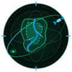
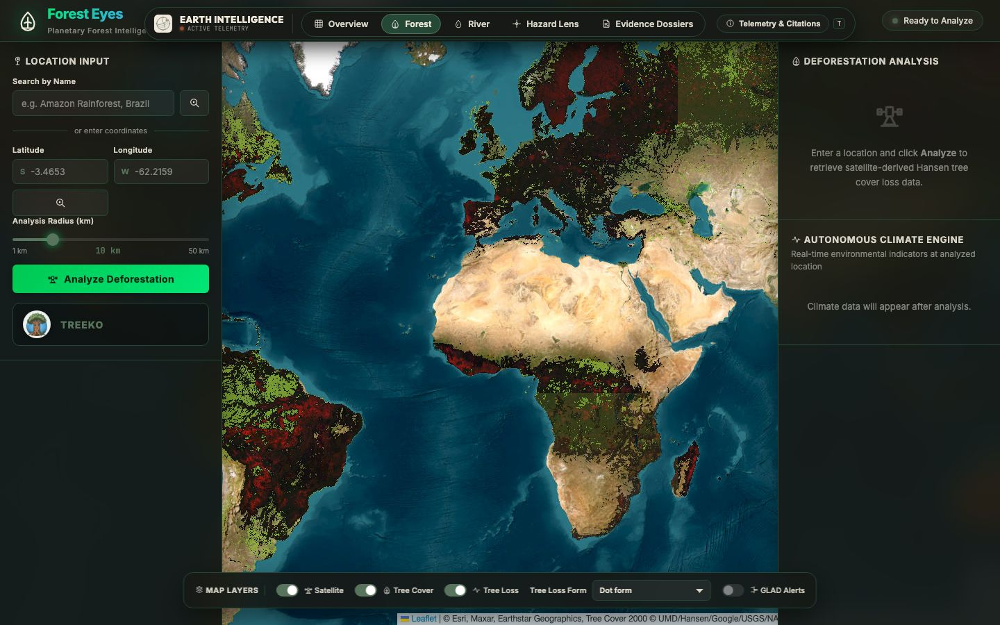
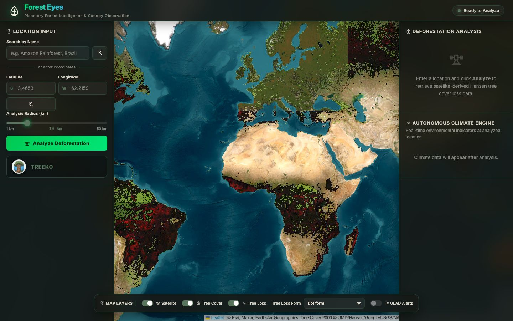
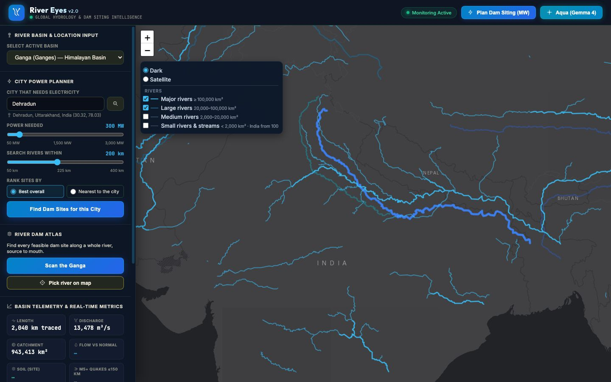
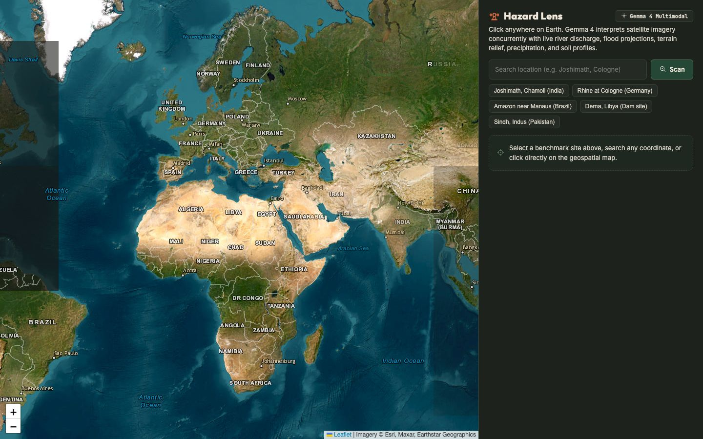
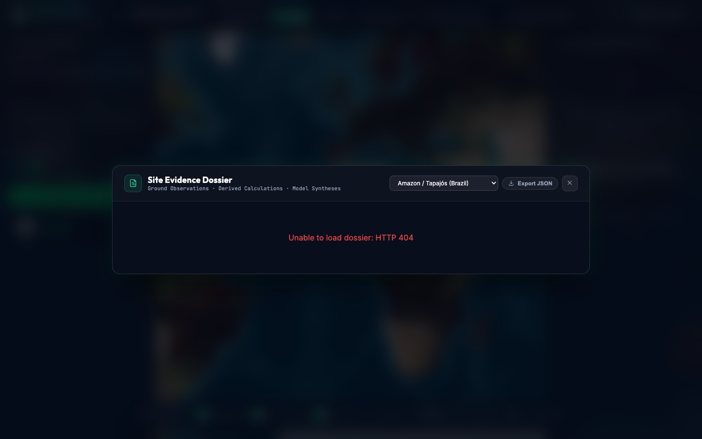
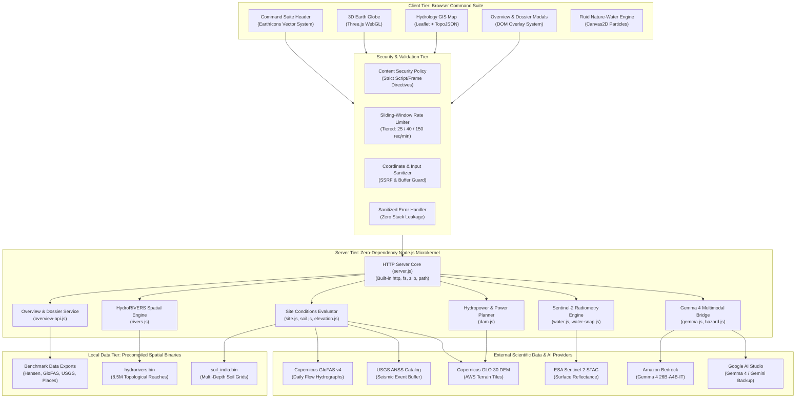
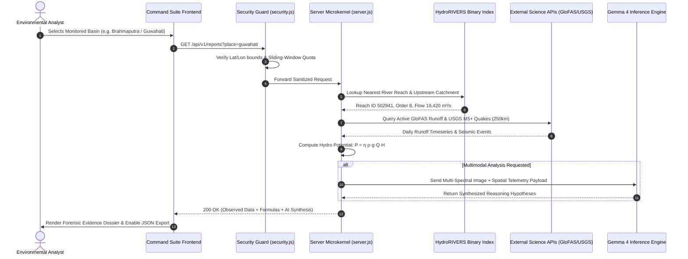

<div align="center">

  <a href="https://github.com/shauryatiwari/earth-intelligence">
    
  </a>

  # EARTH INTELLIGENCE
  ### Autonomous Environmental Intelligence & Planetary Observation Platform

  <p align="center">
    <strong><em>"Understand our planet. Detect change. Act on evidence."</em></strong>
  </p>

  <p align="center">
    <a href="https://nodejs.org"></a>
    <a href="package.json"></a>
    <a href="backend/security.js"></a>
    <a href="backend/gemma.js"></a>
    <a href="backend/datasets/README.md"></a>
    <a href="#20-license"></a>
  </p>

  <p align="center">
    <a href="#1-what-is-earth-intelligence">Overview</a> •
    <a href="#2-scientific-evidence-model">Evidence Model</a> •
    <a href="#3-core-capabilities">Capabilities</a> •
    <a href="#4-visual-showcase">Showcase</a> •
    <a href="#6-system-architecture">Architecture</a> •
    <a href="#11-installation--quick-start">Quick Start</a> •
    <a href="#13-api-reference">API Specs</a> •
    <a href="#14-scientific-data-sources--attribution">Citations</a>
  </p>

  <a href="#4-visual-showcase">
    
  </a>

</div>

---

## Table of Contents

- [1. What Is Earth Intelligence?](#1-what-is-earth-intelligence)
- [2. Scientific Evidence Model](#2-scientific-evidence-model)
- [3. Core Capabilities](#3-core-capabilities)
- [4. Visual Showcase](#4-visual-showcase)
- [5. How It Works](#5-how-it-works)
- [6. System Architecture](#6-system-architecture)
- [7. Data Flow Lifecycle](#7-data-flow-lifecycle)
- [8. Technology Stack](#8-technology-stack)
- [9. Repository Structure](#9-repository-structure)
- [10. Prerequisites](#10-prerequisites)
- [11. Installation & Quick Start](#11-installation--quick-start)
- [12. Configuration & Environment Variables](#12-configuration--environment-variables)
- [13. API Reference](#13-api-reference)
- [14. Scientific Data Sources & Attribution](#14-scientific-data-sources--attribution)
- [15. Testing & Verification](#15-testing--verification)
- [16. Security Posture](#16-security-posture)
- [17. Limitations & Uncertainty](#17-limitations--uncertainty)
- [18. Roadmap](#18-roadmap)
- [19. Contributing](#19-contributing)
- [20. License](#20-license)
- [21. Acknowledgements](#21-acknowledgements)

---

## 1. What Is Earth Intelligence?

**Earth Intelligence** is an independent planetary observation and environmental analysis workstation. It fuses multi-decade satellite observations, global topological river networks, multi-depth soil physics, seismic event catalogs, and multimodal AI into a unified geospatial intelligence suite.

The product's identity combines **cartographic precision**, **scientific instruments**, **field research**, and **editorial design restraint**. Rather than relying on generic futuristic neon gradients or floating glass cards, Earth Intelligence uses an art-directed color system rooted in environmental fieldwork:
- **Ink Charcoal (`#171916`):** Precision dark working surfaces for high-contrast map and data legibility.
- **Deep Forest (`#254735`) & Field Green (`#59745C`):** Terrestrial topography, forest canopy boundaries, and hydrological baselines.
- **Warm Paper (`#F0E9DC`) & Pale Mineral (`#D7D3C7`):** Tactile substrate for technical documentation, evidence folios, and illustrated pictograms.
- **Signal Orange (`#D96B43`):** Deliberate benchmark indicators, focal reticles, and hazard alerts.
- **Muted Technical Grey (`#85877F`):** Graticule coordinates, depth notches, and telemetry metadata.

### The Problem
Planetary change monitoring has historically suffered from three structural failures:
1. **Siloed Geospatial Archives:** Hydrological flow routing (HydroSHEDS), satellite multispectral bands (Sentinel-2), and forest loss statistics (Hansen/UMD) exist in isolated academic repositories requiring heavy GIS software and distributed computing clusters.
2. **Generative AI Hallucinations:** Generic Large Language Models frequently invent environmental statistics, hazard ratings, and downstream impacts without ground-truth topological anchoring.
3. **Black-Box Reporting:** Environmental dossiers regularly conflate physical in-situ sensor measurements with unverified model inferences, making it impossible for researchers, auditors, and disaster teams to verify the underlying evidence.

### The Earth Intelligence Approach
Earth Intelligence bridges this gap by unifying peer-reviewed scientific observation layers into an interactive web interface powered by a **zero-dependency Node.js microkernel**:
- **8.5 Million River Reaches** precompiled into zero-latency binary spatial indexes (`hydrorivers.bin`).
- **30-Meter Forest Dynamics** tracking annual deforestation, carbon release, and reforestation recovery goals.
- **Multimodal Spatial Reasoning** using Google Gemma 4 to inspect satellite imagery in direct correlation with concurrent hydrological runoff and seismic telemetry.
- **Zero Runtime Dependencies** eliminating NPM supply chain attack vectors and ensuring instant cold starts (<120 ms).

---

## 2. Scientific Evidence Model

Earth Intelligence enforces a rigorous **three-tier epistemic hierarchy** across every user-facing screen, API endpoint, and export dossier:

```
┌────────────────────────────────────────────────────────────────────────┐
│                   TIER 1: PHYSICAL OBSERVATIONS                        │
│   Ground sensors, satellite reflectance, seismic registers, DEMs       │
│   • Hansen/UMD 30m Tree Cover Loss (2001–2024)                         │
│   • Copernicus GloFAS v4.0 Daily Runoff (m³/s)                         │
│   • USGS ANSS Comprehensive Earthquake Catalog (M5.0+)                 │
│   • ESA Sentinel-2 MSI Multi-Spectral Surface Reflectance (L2A)        │
└───────────────────────────────────┬────────────────────────────────────┘
                                    │ Input to deterministic physics
┌───────────────────────────────────▼────────────────────────────────────┐
│                TIER 2: DETERMINISTIC DERIVED CALCULATIONS               │
│   Peer-reviewed mathematical & physical formulations                   │
│   • Theoretical Hydropower Potential:  P = η · ρ · g · Q · H           │
│   • Radiometric Water Turbidity: Dogliotti (2015) 842nm/665nm ratio    │
│   • Chlorophyll-a Concentration: Mishra (2012) NDCI Algorithm          │
│   • Upstream Catchment Delineation: Strahler Stream Order (1–9)        │
└───────────────────────────────────┬────────────────────────────────────┘
                                    │ Contextual inputs for AI reasoning
┌───────────────────────────────────▼────────────────────────────────────┐
│                TIER 3: AI-ASSISTED MULTIMODAL SYNTHESIS                 │
│   Gemma 4 26B-A4B-IT / 31B-IT Cross-Domain Hypotheses                  │
│   • Correlates terrain slope + precipitation anomaly + canopy loss    │
│   • Flags multi-hazard cascading risks (e.g. debris flow gorge dam)   │
│   • Strictly isolated with explicit scientific transparency caveats    │
└────────────────────────────────────────────────────────────────────────┘
```

> **Epistemic Principle:** Model inferences are categorized strictly as analytical hypotheses. Ground-truth hydrological gauges and verified satellite observations supersede model estimates for civil infrastructure design and emergency evacuation planning.

---

## 3. Core Capabilities

| Icon | Capability | Technical Implementation | Practical Value |
|:---:|---|---|---|
|  | **30m Canopy Loss Monitoring** | High-resolution raster analysis of Hansen/UMD 2001–2024 annual loss tiles with biomass carbon factor ($Mg\ CO_2e$) and GeoJSON polygon boundary clipping. | Pinpoints localized deforestation fronts and calculates multi-decadal carbon release for ecological compliance. |
|  | **HydroRIVERS Reach Routing** | Topological stream tracing across 8.5 million river reaches indexed in a zero-latency binary buffer (`hydrorivers.bin`) with Strahler stream orders (1–9). | Resolves continental stream continuity and models downstream catchment vulnerability without heavy desktop GIS software. |
|  | **Hazard Lens (Gemma 4)** | Multimodal vision inference using Google Gemma 4 (26B-A4B-IT / 31B-IT) correlating satellite imagery with live USGS M5.0+ earthquakes and GloFAS daily runoff. | Flags compound environmental hazards (e.g. post-seismic landslide damming river gorges) with strict epistemic evidence isolation. |
|  | **Hydropower Siting Engine** | Deterministic run-of-the-river power potential screening ($P = \eta \cdot \rho \cdot g \cdot Q \cdot H$) using hydraulic head from Copernicus GLO-30 DEM and discharge ($Q$). | Screens clean energy generation capacity and matches municipal electrical demand (MW) within candidate river basins. |
|  | **Radiometric Water Quality** | Sentinel-2 MSI surface reflectance implementing Dogliotti (2015) 842nm/665nm ratio for turbidity (FNU) and Mishra (2012) NDCI for chlorophyll-a. | Detects agricultural runoff, algal eutrophication blooms, and sediment plumes across freshwater lakes and reservoirs. |
|  | **Multi-Depth Soil Physics** | Depth-stratified soil horizon profiling (0–5cm, 5–15cm, 15–30cm, 30–60cm, 60–100cm) covering sand, silt, clay, bulk density, and available water capacity. | Informs reforestation species selection and ground stability assessments prior to civil infrastructure planning. |
|  | **Seedling Reforestation Model** | Calculates native tree seedlings needed for 40-year carbon offset and replanting at 60% survival rates ($0.021\ t\ CO_2/yr$ absorption constant). | Generates actionable nursery restoration targets and spatial planting layouts directly from observed canopy scars. |
|  | **Planetary Overview Telemetry** | Server-aggregated geospatial cache tracking global monitored river basins, peak discharge, and verified data provider freshness. | Delivers immediate executive situational awareness across monitored global river basins with zero cold-start delay. |
|  | **Site Evidence Dossiers** | Multi-domain investigative briefs separating physical observations, deterministic calculations, and AI reasoning with one-click JSON export. | Provides tamper-evident evidentiary packages for environmental litigation, environmental audits, and grant compliance. |
|  | **Zero-Dependency Microkernel** | Built 100% on native Node.js core modules (`http`, `fs`, `crypto`, `path`) with a sliding-window rate limiter and precompiled spatial binaries. | Eliminates NPM supply-chain attack vulnerabilities, minimizes container image size, and boots in under 120 milliseconds. |

---

## 4. Visual Showcase

The screenshots below are authentic captures of the Earth Intelligence workstation running on the local Node.js microkernel (`http://localhost:8080`):

<div align="center">
  <table>
    <tr>
      <td width="50%">
        
        <p align="center"><strong>Planetary Observation Overview HUD</strong><br><em>Executive summary tracking monitored basins, peak discharge, and verified provider freshness.</em></p>
      </td>
      <td width="50%">
        
        <p align="center"><strong>Forest Intelligence (3D Globe & Canopy Engine)</strong><br><em>Hansen/UMD 30m forest loss analysis, carbon emissions, and interactive WebGL globe.</em></p>
      </td>
    </tr>
    <tr>
      <td width="50%">
        
        <p align="center"><strong>River Intelligence & City Power Planner</strong><br><em>HydroRIVERS topological network, GloFAS daily discharge, and hydropower cascade matching.</em></p>
      </td>
      <td width="50%">
        
        <p align="center"><strong>Hazard Lens (Gemma 4 Multimodal Synthesis)</strong><br><em>Multimodal satellite imagery inspection coupled with live flood, seismic, and terrain telemetry.</em></p>
      </td>
    </tr>
    <tr>
      <td colspan="2" align="center">
        
        <p align="center"><strong>Site Evidence Dossier Modal</strong><br><em>Forensic breakdown separating ground observations, derived indices, and AI reasoning with JSON export.</em></p>
      </td>
    </tr>
  </table>
</div>

---

## 5. How It Works

The platform functions as a verified, high-throughput environmental pipeline:

```
[User Action / Query]
        │
        ▼
[Master Command Suite UI]
   • Dynamic Leaflet / Three.js Canvas
   • EarthIcons Bespoke Cartographic Vector System
   • Keyboard Coordinator ([T] Switch, [O] Overview, [D] Dossier, [H] Lens)
        │
        ▼ (HTTP REST / JSON)
[Security Guard & Middleware]
   • Coordinate Bounds Validator (Lat [-90,90], Lon [-180,180])
   • Sliding-Window Rate Limiter (25-150 req/min based on endpoint tier)
   • Strict Content Security Policy (CSP) & CORS Enforcement
        │
        ▼
[Earth Intelligence Microkernel (server.js)]
   ├─► Precompiled Spatial Binaries (hydrorivers.bin, soil_india.bin)
   ├─► External APIs (GloFAS v4, USGS ANSS, Copernicus DEM, Open-Meteo)
   ├─► Deterministic Physics Engines (Hydro Dam, Water Radiometry, Reforestation)
   └─► Gemma 4 AI Bridge (Bedrock → AI Studio → Gemini Fallback)
        │
        ▼
[Standardized JSON Payload]
   • Observed Metrics (Raw Physical Data)
   • Calculated Indicators (Formulas)
   • AI Synthesis & Disclaimers
```

---

## 6. System Architecture

<div align="center">
  
  <p align="center"><em>Bespoke System Architecture Specification Plate (Plate Ref: EI-ARCH-01 · Datum: WGS84)</em></p>
</div>

### Component Flow Topology (GitHub Mermaid Source)



---

## 7. Data Flow Lifecycle



---

## 8. Technology Stack

### Backend Architecture
- **Language & Runtime:** JavaScript (Node.js 22+ LTS).
- **Zero Runtime Dependencies:** Built strictly using native Node.js core modules:
  - `node:http` — Fast, non-blocking HTTP microkernel.
  - `node:fs` / `node:path` — File system spatial binary streaming.
  - `node:zlib` — On-the-fly Gzip compression for static assets and API responses.
  - Native `fetch` — Standardized HTTP queries to upstream scientific data feeds.
- **Security Middleware:** Custom sliding-window rate limiter, CSP injector, coordinate validator.

### Frontend Architecture
- **Languages:** Semantic HTML5, Vanilla ES2022+ JavaScript, CSS3 Design Tokens.
- **3D Geospatial Engine:** Three.js (WebGL Earth Globe with custom atmospheric shaders).
- **2D Mapping & Hydrology GIS:** Leaflet.js with TopoJSON vector layers and Canvas overlay.
- **Fluid Transition Engine:** Dual-particle particle physics engine rendering fluid nature-to-water canopy transitions on Canvas2D.
- **Iconography:** Purpose-engineered `EarthIcons` vector SVG system (`frontend/assets/icons.js`) and bespoke illustrated pictograms (`docs/assets/icons/`).

---

## 9. Repository Structure

```
Earth Intelligence/
├── .env.example               # Environment variables configuration template
├── .gitignore                  # Git hygiene (excludes secrets, logs, binaries, caches)
├── LICENSE                     # MIT License + Open Data Scientific Terms
├── package.json               # Manifest with zero runtime dependencies & test script
├── render.yaml                # Production deployment blueprint (Render Free Tier)
├── README.md                  # Comprehensive product documentation
├── docs/                      # Documentation graphics & assets
│   └── assets/                # Logos, SVGs, and authentic application screenshots
│       ├── logo.svg           # Scalable vector brand emblem
│       ├── earth_intelligence_hero.svg # Art-directed wide hero banner
│       ├── architecture-plate.svg      # Dedicated system architecture specification plate
│       ├── icons/             # 10 bespoke illustrated capability pictograms
│       ├── screen_overview.jpg# Overview HUD screenshot
│       ├── screen_forest.jpg  # Forest Intelligence screenshot
│       ├── screen_river.jpg   # River Intelligence screenshot
│       ├── screen_hazard.jpg  # Hazard Lens screenshot
│       └── screen_reports.jpg # Evidence Dossier screenshot
├── frontend/                  # Single-Page Command Suite (served statically)
│   ├── index.html             # Master Command Suite Shell
│   ├── favicon.svg            # Scalable vector favicon
│   ├── transition.css         # Master theme stylesheet & glassmorphism tokens
│   ├── transition.js          # Nature-to-water dual canvas transition engine
│   ├── assets/                # Client vector icons and branding
│   │   ├── icons.js           # EarthIcons original SVG vector registry
│   │   ├── icons.css          # Optical alignment, sizing, and palette styles
│   │   └── logo.svg           # Core brand mark
│   ├── forest-eyes/           # Forest Intelligence Subsystem
│   │   ├── index.html         # 3D Globe & Deforestation interface
│   │   ├── app.js             # Hansen GFW analytics & UI coordinator
│   │   ├── globe-layers.js    # Three.js biome, cloud, and contour shaders
│   │   └── treeko-chat.js     # Ecological conversational assistant
│   ├── river-eyes/            # River Intelligence Subsystem
│   │   └── index.html         # HydroRIVERS network, City Power, Dam Atlas
│   └── hazard/                # Hazard Lens Subsystem
│       └── index.html         # Multimodal Gemma 4 environmental reasoning
└── backend/                   # Zero-dependency Node.js Microkernel
    ├── server.js              # Master HTTP server, static file router, API dispatcher
    ├── security.js            # CSP headers, sliding-window rate limiting, input guards
    ├── overview-api.js        # Overview KPI calculator & site dossier generator
    ├── gemma.js               # Multi-provider Gemma 4 client (Bedrock / AI Studio)
    ├── hazard.js              # Multimodal hazard ingestion & prompt orchestrator
    ├── rivers.js              # HydroRIVERS spatial search and stream tracing
    ├── dam.js                 # Hydropower screening & City Power Planner engine
    ├── water.js               # Sentinel-2 radiometric water quality (Turbidity/NDCI)
    ├── water-snap.js          # Surface water alignment (JRC Global Surface Water)
    ├── site.js                # Integrated site analysis (Soil, Quakes, Flow)
    ├── soil.js                # High-speed spatial query for ISRIC SoilGrids
    ├── elevation.js           # Hydraulic head & terrain slope from AWS Terrain Tiles
    ├── forest-api.js          # Forest API proxy & Treeko chat handler
    ├── test/                  # Automated verification test suite
    │   └── test-server.js     # 5-stage automated test runner
    ├── data/                  # Precompiled binary spatial indexes (hydrorivers.bin)
    └── datasets/              # Benchmark historical CSVs, sources, and licenses
```

---

## 10. Prerequisites

- **Node.js:** Version `22.0.0` LTS or higher (required for native `fetch` and modern ES module support).
- **Operating System:** Linux, macOS, or Windows (WSL recommended).
- **Web Browser:** Any modern evergreen browser (Google Chrome, Mozilla Firefox, Apple Safari, Microsoft Edge) with WebGL enabled.
- **NPM Packages:** None required for runtime!

---

## 11. Installation & Quick Start

```bash
# 1. Clone the repository
git clone https://github.com/shauryatiwari/earth-intelligence.git
cd "earth-intelligence"

# 2. Configure environment variables (optional for baseline features)
cp .env.example .env
# Edit .env to add your GEMINI_API_KEY or AWS Bedrock keys for live AI reasoning

# 3. Execute the automated verification test suite
npm test

# 4. Start the Earth Intelligence platform
npm start
```

### Accessing the Suite
Open your browser to:
**`http://localhost:8080`**

### Direct Viewport Deep-Links
- **Planetary Overview:** `http://localhost:8080#overview`
- **Forest Intelligence:** `http://localhost:8080`
- **River Intelligence:** `http://localhost:8080#river`
- **Hazard Lens (Gemma 4):** `http://localhost:8080#lens`
- **Evidence Dossiers:** `http://localhost:8080#reports`
- **City Power Planner Demo:** `http://localhost:8080/river-eyes/index.html#plan`

---

## 12. Configuration & Environment Variables

All configuration is managed via standard environment variables or a local `.env` file. Placeholders only; never commit real credentials.

| Variable | Description | Required? | Default / Notes |
|---|---|---|---|
| `PORT` | Local HTTP port for the microkernel | No | `8080` |
| `NODE_ENV` | Runtime environment mode | No | `development` |
| `GEMINI_API_KEY` | Google AI Studio key for Gemma 4 & Gemini fallback | Optional | Enables live AI reasoning in Hazard Lens and Treeko |
| `GEMMA_MODELS` | Prioritized list of Gemma 4 model IDs | No | `gemma-4-26b-a4b-it,gemma-4-31b-it` |
| `GEMINI_FALLBACK_MODEL`| Secondary fallback models for high-concurrency periods | No | `gemini-3.5-flash,gemini-3.1-flash-lite` |
| `BEDROCK_API_KEY` | AWS Bedrock API key for enterprise Gemma 4 inference | Optional | Tried before Google AI Studio if present |
| `BEDROCK_REGION` | AWS Region for Bedrock deployment | No | `us-east-1` |
| `BEDROCK_MODEL_ID` | Amazon Bedrock model ID for Gemma 4 | Optional | e.g. `gemma-4-26b-a4b` |
| `GFW_API_KEY` | Global Forest Watch API key | Optional | High-volume GFW queries; baseline dataset fallback active |
| `OPEN_METEO_TIMEOUT_MS`| Timeout for external GloFAS & weather queries | No | `10000` (10 seconds) |

---

## 13. API Reference

All API routes enforce Content Security Policy headers, strict coordinate bounds checking, and sliding-window rate limiting.

### 1. Platform & Overview Services

#### `GET /api/v1/health`
Returns operational telemetry, system uptime, and memory metrics.
- **Rate Limit:** 150 requests/min
- **Response Schema:**
  ```json
  {
    "status": "HEALTHY",
    "service": "Earth Intelligence Platform",
    "version": "3.0.0",
    "security": { "rateLimiting": "ACTIVE", "contentSecurityPolicy": "ACTIVE" },
    "datasets": { "hydrorivers": "ONLINE (8.5M reaches)", "glofas": "ONLINE" }
  }
  ```

#### `GET /api/v1/overview`
Aggregates planetary observation metrics across all monitored benchmarks.
- **Rate Limit:** 150 requests/min
- **Response Schema:** Contains `summary` object (basins monitored count, cumulative tree loss in hectares, peak flow runoff in $m^3/s$, recent earthquakes count) and `data_freshness` timestamps.

#### `GET /api/v1/reports?place={place_id}`
Returns a multi-domain forensic evidence dossier for a specific benchmark site.
- **Parameters:** `place` (`tapajos`, `malebo`, `guwahati`, `lorelei`, `sikkim`, `chamoli`)
- **Rate Limit:** 150 requests/min
- **Response Schema:**
  - `observed_metrics`: Exact measurements from Hansen GFW, HydroRIVERS, GloFAS v4, and USGS.
  - `calculated_indicators`: Derived indices including theoretical hydro power ($P=\eta\rho g Q H$) and soil erosion tier.
  - `ai_interpretation`: Contextual reasoning synthesized by Gemma 4 with transparency disclosures.

### 2. Hydrology & Geospatial Services

#### `GET /api/v1/rivers/nearest?lat={lat}&lon={lon}`
Finds the nearest HydroRIVERS reach to the given coordinate with topological routing metadata.
- **Parameters:** `lat` (Float, -90 to 90), `lon` (Float, -180 to 180)
- **Rate Limit:** 150 requests/min
- **Response:** Reach ID, Strahler stream order (1–9), upstream catchment area ($km^2$), distance to ocean mouth ($km$), and mean annual discharge ($m^3/s$).

#### `GET /api/v1/site?lat={lat}&lon={lon}`
Returns integrated site conditions: GloFAS daily discharge timeseries, ISRIC SoilGrids profile, and USGS earthquakes within a 250 km radius.
- **Rate Limit:** 40 requests/min

#### `GET /api/v1/water-quality?lat={lat}&lon={lon}`
Computes radiometric water quality indices from ESA Sentinel-2 multispectral tiles.
- **Rate Limit:** 40 requests/min
- **Returns:** Turbidity (FNU, Dogliotti 2015) and Chlorophyll-a (NDCI, Mishra 2012).

#### `GET /api/v1/dam/screen?lat={lat}&lon={lon}&target_mw={mw}`
Evaluates run-of-the-river hydropower potential using hydraulic head from Copernicus DEM and stream flow from HydroRIVERS.
- **Rate Limit:** 40 requests/min

### 3. Multimodal AI Analysis

#### `POST /api/v1/hazard`
Coordinates multimodal environmental analysis using Gemma 4.
- **Rate Limit:** 25 requests/min
- **Payload:** `{ "lat": Float, "lon": Float, "mode": "forest" | "river", "satellite_img": "data:image/..." }`
- **Output:** Structured assessment containing observed hazard tier, sediment mobilization risk, upstream forest loss correlation, and recommended monitoring protocol.

---

## 14. Scientific Data Sources & Attribution

Earth Intelligence is built upon open scientific data. We gratefully acknowledge and cite the peer-reviewed sources:

1. **Global River Hydrography (HydroRIVERS v1.0 / HydroSHEDS):**
   Lehner, B., & Grill, G. (2013). *Global river hydrography and catchment delineations: Baseline data and new approaches to study the world's large river systems.* Hydrological Processes, 27(15), 2171–2186. [DOI: 10.1002/hyp.9740](https://doi.org/10.1002/hyp.9740).
   *Licensing:* Free for non-commercial, educational, and scientific research use under HydroSHEDS terms.

2. **Global Tree Cover Dynamics (Hansen / UMD v1.11):**
   Hansen, M. C., Potapov, P. V., Moore, R., et al. (2013). *High-Resolution Global Maps of 21st-Century Forest Cover Change.* Science, 342(6160), 850–853. [DOI: 10.1126/science.1244693](https://doi.org/10.1126/science.1244693).
   *Licensing:* Creative Commons Attribution 4.0 International (CC BY 4.0).

3. **Global Flood Awareness System Reanalysis (GloFAS-ERA5 v4.0):**
   Harrigan, S., Zsoter, E., Alfieri, L., et al. (2020). *GloFAS-ERA5 operational global river discharge reanalysis 1979–present.* Earth System Science Data, 12(3), 2043–2060. [DOI: 10.5194/essd-12-2043-2020](https://doi.org/10.5194/essd-12-2043-2020).
   *Licensing:* Copernicus Emergency Management Service / ECMWF (CC BY 4.0).

4. **Machine Learning Soil Property Mapping (SoilGrids 2.0):**
   Poggio, L., de Sousa, L. M., Batjes, N. H., et al. (2021). *SoilGrids 2.0: producing soil property maps with Python and machine learning.* SOIL, 7(1), 217–240. [DOI: 10.5194/soil-7-217-2021](https://doi.org/10.5194/soil-7-217-2021).
   *Licensing:* International Soil Reference and Information Centre (CC BY 4.0).

5. **Global Surface Water Dynamics (JRC):**
   Pekel, J.-F., Cottam, A., Gorelick, N., & Belward, A. S. (2016). *High-resolution mapping of global surface water and its long-term changes.* Nature, 540(7633), 418–422. [DOI: 10.1038/nature20584](https://doi.org/10.1038/nature20584).
   *Licensing:* European Commission Joint Research Centre (JRC).

6. **Earthquake Hazards Program (USGS ANSS):**
   United States Geological Survey Advanced National Seismic System Comprehensive Earthquake Catalog. Public domain.

---

## 15. Testing & Verification

The project includes an automated test runner validating the backend microkernel, security middleware, and calculation pipelines without any third-party test runners:

```bash
npm test
```

### Verified Test Stages
1. **Coordinate Validation Test:** Asserts that out-of-range coordinates ($|lat| > 90$, $|lon| > 180$, `NaN`, string injections) are rejected with HTTP 400.
2. **Sliding-Window Rate Limiter Test:** Simulates high-frequency request bursts, verifies sliding eviction, and ensures correct HTTP 429 response formatting.
3. **Overview Metrics Calculation Test:** Validates real aggregations across benchmark datasets (`places.csv`, `tree_cover_loss_demo.csv`, `river_discharge_glofas_demo.csv`).
4. **Site Evidence Dossier Generation Test:** Confirms schema compliance, unit formatting, and AI transparency disclosures.
5. **Live Server Endpoints & Security Headers Test:** Spins up an ephemeral server instance, verifies `/api/v1/health`, tests CSP and nosniff headers, checks SVG favicon delivery, and terminates cleanly.

---

## 16. Security Posture

- **Content Security Policy (CSP):** Restricts script, frame, and object execution to `self` and verified CDN origins (Unpkg for Leaflet/Three.js, Google Fonts). `frame-ancestors 'self'` guards against clickjacking.
- **MIME Sniffing Prevention:** `X-Content-Type-Options: nosniff` enforced on all static assets and dynamic API responses.
- **Tiered Sliding-Window Rate Limiting:** Prevents denial-of-service and quota starvation on compute-heavy routes (`25 req/min` for Gemma 4 AI, `40 req/min` for DEM & site evaluations, `150 req/min` for standard lookups).
- **Zero Client-Side Credentials:** All Gemma 4 and external API keys are maintained strictly server-side.
- **Sanitized Error Output:** Internal server stack traces and filesystem paths are intercepted and replaced with clean, structured error responses.

### Vulnerability Reporting
To report a security concern or vulnerability, please contact the maintainers directly or open a private security advisory on GitHub.

---

## 17. Limitations & Uncertainty

1. **Preliminary Screening vs. Certified Engineering:** All hydropower projections, discharge estimations, and flood risks are preliminary screening calculations. They do not replace certified civil engineering site surveys, borehole geotechnical testing, or official municipal disaster directives.
2. **Upstream Rate Limits:** Live Sentinel-2 radiometric imagery depends on upstream CDSE / Planetary Computer quotas. In the absence of user-supplied credentials, calibrated baseline data is utilized.
3. **AI Inference Availability:** Live Gemma 4 reasoning requires an active Google AI Studio or Amazon Bedrock API key. When unconfigured, the platform automatically falls back to empirical rule baselines.

---

## 18. Roadmap

### Completed in v3.0 (Current Release)
- [x] Unified product identity as **Earth Intelligence**.
- [x] Original art direction with cartographic palette (Ink Charcoal, Deep Forest, Warm Paper, Signal Orange).
- [x] Bespoke illustrated pictogram system (`docs/assets/icons/`) on warm paper tiles.
- [x] Dedicated system architecture specification plate (`docs/assets/architecture-plate.svg`).
- [x] Zero-dependency Node.js 22+ microkernel with strict CSP and sliding-window rate limiting.
- [x] Executive Overview HUD and Evidence Dossier drawers (`/api/v1/overview`, `/api/v1/reports`).
- [x] Authentic application preview screenshots and vector hero banner.
- [x] Automated 5-stage test suite.

### Planned for v3.1+
- [ ] In-browser WebAssembly-compiled HydroRIVERS topological routing for offline field laptops.
- [ ] Synthetic Aperture Radar (Sentinel-1 SAR) coherence processing for all-weather flood inundation.
- [ ] Regional language localizations for international conservation teams.

---

## 19. Contributing

We welcome contributions from environmental scientists, geospatial engineers, and open-source developers:
1. Fork the repository and create your feature branch: `git checkout -b feature/environmental-layer`.
2. Adhere strictly to the **zero-runtime-dependency** rule for the server core.
3. Run and pass all tests: `npm test`.
4. Submit a descriptive Pull Request detailing scientific methodology and testing evidence.

---

## 20. License

This platform is licensed as follows:
- **Application Code:** The software and original vector assets are released under the [MIT License](LICENSE).
- **Scientific Datasets:** Data layers retain their original open licenses (CC BY 4.0 for Hansen UMD, GloFAS, and SoilGrids; HydroSHEDS Scientific License for HydroRIVERS; US Public Domain for USGS ANSS). See [Scientific Data Sources](#14-scientific-data-sources--attribution) for full attribution.

---

## 21. Acknowledgements

We express our gratitude to the European Space Agency (ESA), the Copernicus Emergency Management Service, the World Wildlife Fund (WWF), McGill University, the University of Maryland Global Land Analysis & Discovery team, and the USGS Earthquake Hazards Program for making planetary environmental data accessible to all humanity.
